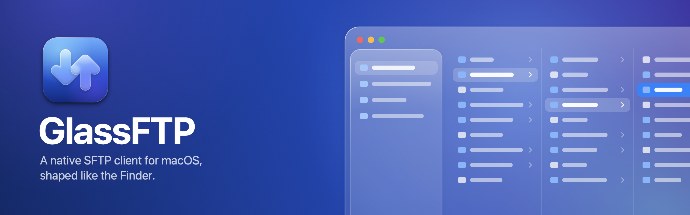

<p align="center">
  
</p>

# GlassFTP

A native macOS SFTP client with a Finder-shaped interface and a Liquid Glass
surface. Built for macOS 26.

## Install

Requires macOS 26 on an Apple Silicon Mac.

1. Download **`GlassFTP-<version>.dmg`** from the [Releases](../../releases) page.
2. Open it and drag **GlassFTP** onto the **Applications** folder.
3. The app is not notarized yet, so macOS blocks the first launch: open it
   once, then go to **System Settings › Privacy & Security** and click
   **Open Anyway**. Or, in Terminal:

   ```
   xattr -dr com.apple.quarantine /Applications/GlassFTP.app
   ```

Or build it yourself — see [Building](#building).

## What it does

- **Connections** — saved in `~/Library/Application Support/GlassFTP/connections.json`;
  passwords go to the login Keychain, never to that file.
- **Browsing** — Icon, List and Column views (⌘1 / ⌘2 / ⌘3) with real Finder
  icons, sortable columns, back / forward history, a clickable path bar, and
  search within the current folder (⌘F or ⌃F).
- **Keyboard** — arrows move the selection, `→` steps into a folder and `←`
  steps back out (landing on the folder you left), `⌘↓` or `Return` opens,
  `⌘↑` goes to the enclosing folder. In Icon view the arrows move through the
  grid, so up and down cross a row at a time. In Column view `→` and `←` walk
  the hierarchy one column at a time, as in the Finder.
- **Shortcuts** — bookmark any folder on a server into the sidebar's Shortcuts
  section. Opening one connects to its server if needed and lands directly in
  the folder.
- **Scoped roots** — a connection with a remote path set is rooted there:
  the path bar starts at that folder and navigation cannot climb above it.
- **Preview** — space bar opens a Quick Look-style panel that follows the
  selection as the arrows move it. Images, PDFs and text/source files (with line
  numbers) render inline; folders list their contents; space or escape
  dismisses it.
- **Path bar** — the Finder's path and status bars along the bottom: every
  folder of the current path as a clickable crumb, with the item count and
  selection underneath. **View › Hide Path Bar** or ⌥⌘P toggles it. Files
  dropped on a crumb upload into that folder; ⌘L or a double-click on its empty
  end edits the path as text.
- **Go to Folder** — ⌘⇧G drops the Finder's panel down from the top of the window: absolute or relative paths, `~`
  and `..`, Tab completion, recent folders. A path to a file opens its folder
  with the file selected.
- **Transfers** — up to ten files at once (four by default), each on its own
  SSH connection, separate from the one that browses. Recursive folders,
  per-job speed and time remaining, cancellation. An existing destination is
  handled per Settings — ask, overwrite, overwrite if newer or if the size
  differs, resume, keep both or skip — and failed files are retried on a fresh
  connection, resuming where they stopped.
- **Settings** (⌘,) — General, Transfers, Connection, Proxy and Advanced
  tabs; every option is explained in place and each tab resets on its own.
- **Proxy** — SOCKS5, HTTP CONNECT, or the system's proxy settings, set
  globally; each connection can use the default, connect directly, or carry its
  own.
- **Authentication** — password, or a private key: ed25519 and RSA in OpenSSH
  format (passphrase-protected included), ECDSA in PEM. Passwords and
  passphrases live in the Keychain.
- **Drag and drop** — drag from the Finder to upload; drag remote files out to
  the Finder to download them; drag files and folders onto another folder on
  the server to move them (a server-side rename, nothing is re-transferred).
  Hovering a folder during a drag springs it open.
- **File operations** — new folder, rename, delete, `chmod` from Get Info, copy
  path.
- **Host keys** — trust-on-first-use against `~/.ssh/known_hosts`, sharing the
  same file as OpenSSH. A pinned host that presents a different key of the same
  type is refused outright, with no override.

Only SFTP is implemented, but everything above the `FileProvider` protocol is
protocol-agnostic, so a second transport does not touch the UI.

## Building

There is no Xcode project. The app is a SwiftPM executable plus a script that
assembles the bundle, which means Command Line Tools alone are enough.

```
make run          # release build, bundle, launch
make test         # run the assertion suite
make debug        # same, debug configuration
make bundle       # build/GlassFTP.app without launching
make dist         # release build: dist/GlassFTP-<version>.zip and .dmg
make icon         # regenerate Resources/AppIcon.icns
make banner       # regenerate the README banner, docs/banner.png
make clean
```

Requires macOS 26 (the Liquid Glass APIs) and Swift 6.

### Tests

Command Line Tools do not ship XCTest, so `swift test` is unavailable. The
assertions for the pure logic — `known_hosts` parsing above all — live in
`Sources/GlassFTP/SelfTest.swift` and run via `make test`.

### The Keychain prompt

`scripts/bundle.sh` signs ad hoc, and an ad-hoc signature changes with every
build. macOS ties Keychain access to the signature, so it re-asks for permission
after each rebuild — "Always Allow" holds until the next one. Signing with a
Developer ID identity removes the prompt for good.

## Column view

The column browser is AppKit: one `NSTableView` per column, laid side by side in
a horizontal scroll view, reused by path so walking the hierarchy never rebuilds
a column that is still on screen. Selecting a folder lists it in the next column
without leaving the current one, as in the Finder, and the window title follows
it. A file gets a preview column with its details, Quick Look and Download.

Columns resize from the handle at their foot; ⌥-drag resizes them all and
becomes the default width, and a double-click fits the longest name. A
horizontal two-finger swipe scrolls the whole strip rather than the column
under the pointer.

## Working at scale

Built for folders of tens of thousands of files and files of tens of gigabytes.
Two things dominate at that size.

### Rendering

`visibleEntries` used to be a computed property that filtered and sorted on
every read — and it is read several times per render pass, by the table, the
path bar, the overlays and the keyboard handlers. At 50,000 entries with
`localizedStandardCompare` that was roughly 800 ms *per read*.

Three changes, measured by the benchmark in `make test`:

1. **Stored, not computed.** Rebuilt only when the entries, the sort order or
   the applied query change.
2. **Precomputed keys.** `RemoteEntry` carries `sortKey` (lowercased, digit runs
   zero-padded so a plain `<` orders `file2` before `file10`), `searchKey` and
   `kindLabel`. Table columns sort with `.lexical` rather than the default
   `.localizedStandard` — the key already did the folding, so paying for a
   collation per comparison would undo the point.
3. **Index sorting.** `RemoteEntry` holds five reference-counted strings, so
   moving one during a sort costs five retain/release pairs. Sorting an array of
   indices against flat key arrays, borrowed through unsafe buffers, removes
   that traffic entirely.

Release timings for 50,000 entries: sort by name **26 ms**, by kind **43 ms**,
by size **22 ms**, filter **67 ms** — and reads are free.

### Transfers

One 32 KB chunk in flight caps throughput by latency rather than bandwidth: at
50 ms round trip that is ~640 KB/s no matter how fast the link is. Transfers now
keep **16 chunk requests in flight**, writing with `pwrite` at absolute offsets
(`FileHandle.seek` + `write` is two steps against one shared offset and cannot
be used concurrently). The file is deliberately *not* pre-allocated: after a
crash a pre-allocated file has its final size and nothing says how much of it
is real, whereas without it the size is the highest offset written.

Each chunk loops until it is full or the file ends. A server may legally return
fewer bytes than asked for without being at EOF, and with workers writing at
fixed offsets, accepting a short read would punch a hole in the middle of the
file — corruption that produces a file of exactly the right size.

Progress is throttled to ten reports a second; unthrottled, a 50 GB file would
hop to the main actor over a million times.

### Memory and queue

- Listings are cached in a bounded LRU (`ListingCache`), budgeted in entries
  rather than folders since folder sizes vary by orders of magnitude. The folder
  on screen is pinned and never evicted.
- Child prefetch is skipped when the current folder holds more than 2,000
  entries, or when the cache is already at budget.
- A folder transfer is **one job**, not one row per file: tens of thousands of
  observable objects for a single drag is not viable. The tree is walked and
  transferred in the same pass, off the main actor, so bytes start moving as
  soon as the first folder is listed and the file count grows as it goes.

## Navigation latency

A single SFTP `listDirectory` is several sequential round trips — realpath,
opendir, one or more readdirs, close — so on anything but a LAN the wait between
folders is very visible. Three things hide it:

- **Cache-first rendering.** A folder already listed appears instantly and is
  revalidated behind the content; the new listing swaps in only if it changed
  and the user is still there. Back, forward and re-entering a folder cost
  nothing.
- **Hover warming.** Pointing at a folder starts its listing. The pointer
  reliably arrives before the click, which covers most of the round trip.
- **Child prefetch.** After a folder loads, up to 24 of its subfolders are
  warmed in the background, 250 ms later so that walking quickly through a deep
  path does not queue work for every folder passed through.

The prefetch is cancelled on every navigation. The provider is an actor and
serializes its requests, so leaving stale prefetches queued would put the user's
own click behind them.

### Parallel files and resume

Pipelining fixes large files; many small files are bound by per-file round
trips (open, stat, close) instead, which only overlap across connections. The
transfer manager schedules *files*, across all jobs, onto `TransferPool`
connections — so a folder of ten thousand files keeps several connections busy,
and browsing never waits behind a download. A job is still one row with
aggregate counters.

Resuming backs off from the end of the partial file by `pipelineDepth ×
chunkSize` at their largest settings (4 MB): chunks land out of order, so the
bytes just below the end may hold holes left by requests still in flight when
the transfer stopped.

### Proxies

Citadel's bootstrap always dials the SSH host, and NIOSOCKS lives in
swift-nio-extras, so `ProxyConnector` opens the channel itself, runs the SOCKS5
or CONNECT handshake, and hands the channel to `SSHClient.connect(on:)`. The
SSH server's banner can arrive in the same read as the proxy's final reply; it
is held back and delivered once the SSH handler has sent its first bytes.

## Layout

```
Sources/GlassFTP/
  Core/     FileProvider protocol, RemoteEntry, POSIX path helpers, errors
  SFTP/     Citadel-backed provider, chunked transfers, known_hosts + TOFU
  Model/    connections, Keychain, browser state, transfer queue and planner
  UI/       SwiftUI views
  AppKit/   column browser, drag-out file promises
```

Everything Citadel-shaped stays inside `SFTP/`. `RemoteEntry` is the only
file-description type the UI sees.

## Known limitations

- **RSA host keys are not supported.** The NIOSSH build underneath Citadel
  cannot represent an `ssh-rsa` host key, so such `known_hosts` lines are
  skipped and a server offering only an RSA host key will not connect. Every
  current OpenSSH offers ed25519 or ECDSA, so this shows up only on quite old
  servers.
- **No `ssh-agent` or `~/.ssh/config` import.** Keys are read from a file
  per connection. OpenSSH-format ECDSA keys need converting to PEM
  (`ssh-keygen -p -m PEM`); encrypted PEM keys are not supported.
- **No speed limit.** Transfers use whatever bandwidth they get.
- **Sorting is not locale-collated.** The precomputed key folds case and orders
  numbers naturally, but accents sort by their lowercased form. That is the
  price of sorting 50,000 entries in tens of milliseconds.
- **A cold listing still waits for the whole folder.** Citadel returns a
  directory all-or-nothing and its request API is `internal`, so progressive
  display would mean vendoring its SFTP client.
- **No Gallery view.** The Finder's fourth mode needs a thumbnail per file,
  which would mean downloading the whole folder to draw the grid.
- **Previews are capped**: 64 KB for text, 16 MB for images and PDFs. A large
  text file shows its head, flagged as truncated; an oversized image shows
  whatever decodes from the capped read. Archives, disk images and media are
  never fetched — there is nothing to render, so the panel shows their details
  and a Download button. A PDF over the cap is refused without fetching, since a
  truncated one has no cross-reference table and will never open.

## Dependency note

`Citadel` 0.12.1 resolves `NIOSSH` through `Wellz26/swift-nio-ssh`, a third-party
fork of the Citadel author's fork of `apple/swift-nio-ssh` — not Apple's
package. The version is pinned exactly and `Package.resolved` records the
resolved revisions. Worth revisiting if Citadel points back at upstream.

## License

MIT — see [LICENSE](LICENSE).
